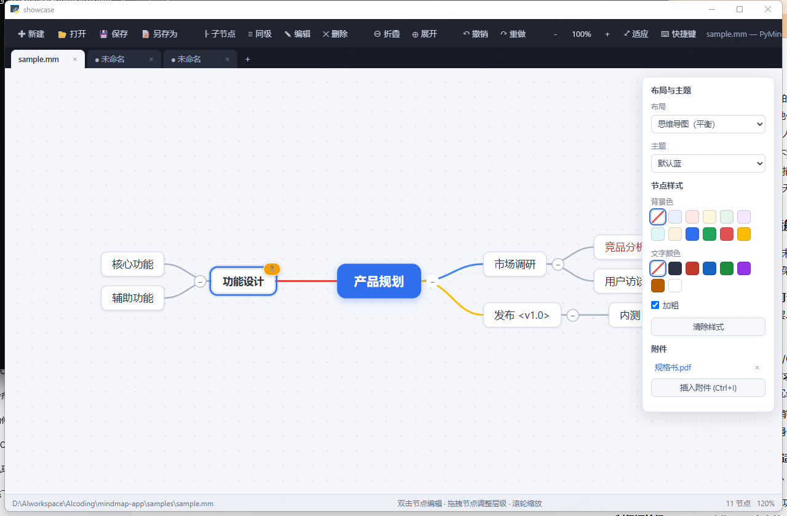

# PyMindplot 便携思维导图

类似 XMind 的 Windows 桌面思维导图应用。Python + pywebview（系统 WebView2）+ PyInstaller 打包为**免安装、单文件便携 EXE**（约 11.9 MB）。



## 功能

- **多标签页**：顶部标签栏（Chrome 风格）——新建（Ctrl+T / + 按钮）、关闭（Ctrl+W / × / 中键点击）、切换（点击 / Ctrl+Tab 循环）；每个标签页独立持有导图内容、布局主题、视图缩放平移、撤销历史与选中状态，切换后不丢失；未保存的标签页标题带 ● 标记，关闭时确认
- **6 种布局模式**（右侧面板「布局」下拉，即时切换，跟随文件保存）：
  思维导图（平衡）、逻辑图（向右）、组织结构图（向下）、树状图、时间轴（水平）、鱼骨图（头向右）
- **6 套主题**（右侧面板「主题」下拉，跟随文件保存）：
  默认蓝、极简白、暗黑、暖橙、森绿、紫青；节点手动设置的颜色始终优先于主题
- **画布**：中心发散树状布局，滚轮缩放（围绕光标）、空白拖拽平移、适应画布
- **节点操作**：新建导图、Tab 添加子节点、Enter 添加同级节点、双击/F2 编辑文字（输入框自动沿用节点配色，任何背景下输入内容实时可见）、Delete 删除、拖拽调整层级与顺序（悬停中部=作为子节点，上下边缘=排序）
- **右键菜单**：右键任意节点弹出上下文菜单——添加子主题、添加同级主题、编辑文字、展开/折叠子主题、剪切、复制、粘贴、**插入附件**、**附件另存为**（仅有附件的格子显示可用）、删除；按节点状态自动禁用不可用项（如根节点不能删除/剪切）
- **文件粘贴**：复制文件（zip/任意格式）后在格子上按 Ctrl+V，文件作为附件内嵌进该格子，**完整文件名（含扩展名）自动填入格子**；粘贴文本/截图的行为不变
- **附件另存为**：右键有附件的格子 →「附件另存为」→ 选择位置保存，内容与原文件逐字节一致（旧版 .assets 附件同样支持）
- **剪切/复制/粘贴**：Ctrl+C 复制、Ctrl+X 剪切（节点半透明标记）、Ctrl+V 粘贴到选中节点下方；剪切的节点粘贴时为**移动**，复制的节点粘贴时生成**副本**（含子树与附件引用）
- **折叠/展开**：节点旁圆形按钮（显示折叠的子孙数量），Space 快捷切换，工具栏一键全部折叠/展开
- **附件**：
  - 选中节点 → 侧栏「附件」→ 插入附件（Ctrl+Shift+I）；或点击节点右上角的 **📎 徽标** → 弹出附件菜单 → 插入/打开/移除
  - 有附件的节点右上角显示橙色 📎 徽标（多个附件显示数量），**从格子上直接访问附件**
  - **附件内容直接嵌入 .mm 文件内部**（任意后缀：.rar/.zip/.stp/.txt…），磁盘上不再生成 `.assets` 文件夹，单文件即可拷贝分享；打开附件时自动解压到临时目录并用系统关联程序打开
  - **兼容旧版**：旧文档中引用 `.assets` 文件夹的附件与图片仍可正常打开与显示（自动经内部桥接读取）
  - **插入/移除附件后自动保存**，关联立即写入 .mm 文件，不会因关闭而丢失
  - 删除节点时其附件引用一并移除（嵌入内容随节点删除；.assets 旧文件保留）
- **查找与替换**：Ctrl+F（查找）/ Ctrl+H（查找替换）打开面板；实时高亮全部匹配并显示「当前/总数」（如 3/17），Enter/Shift+Enter/F3 在匹配间循环跳转（自动展开折叠分支并定位视图）；可选**区分大小写**、**全字匹配**；支持替换当前处与全部替换（全部替换前弹确认框，显示将替换的数量）；无匹配/输入为空有明确提示，关闭面板即清除高亮
- **右键框选批量删除**：在空白处按住右键拖拽画出选框，松开即选中框内所有节点（虚线高亮），按 Del 一键批量删除（根节点受保护）；右键单击节点仍是上下文菜单
- **节点字号按层级自动缩放**：根 18px → 一级 16px → 二级 15px → 三级 14px → 更深 13px，层级越高字号越大，无需手动设置；在面板中显式设置的字号优先生效
- **追踪模式**：工具栏「◎追踪」按钮或 **F4** 一键开关；开启后以选中格子为中心呈现**圆形聚焦区**（半径 = 视口短边 × 范围百分比，默认 65%，带虚线参考圈），区内格子完整显示、**仅选中格子放大 1.5 倍**（倍数可调）；圆外到视口边缘之间格子与连线**渐变虚化**（越靠外越淡）；**屏外高层祖先与屏内格子之间的连线保持可见**（向屏外方向渐隐，不会因祖先移出视口而断线）；方向键移动选中格子时圆形区域平滑跟随；工具栏追踪按钮左侧两个输入框分别设定**显示范围（20–100%）**与**放大倍数（1–3，仅选中格）**，修改立即生效并自动钳制；再次按 F4 恢复完整显示
- **选中格子置顶**：选中格子始终显示在最顶层（z-index 提升），追踪模式下放大后即使与相邻格子重叠也不会被遮挡（拖拽中的格子层级更高）
- **追踪方向切换（悬浮迷你导图）**：追踪模式下选中格子后按**左/右方向键**：该侧只有 1 个相连格子（父格/子格）时**跳过选择直接切换**；多于 1 个时以选中格子为中心弹出**悬浮迷你思维导图**——按当前连接方式（贝塞尔曲线）展示其左侧与右侧的父格和子格；**视觉采用苹果设计语言**：系统蓝 #007AFF 单一强调色、中性灰文字层级（#1D1D1F/#6E6E73/#86868B）、SF Pro/PingFang 字体栈、hairline 描边与柔和多层投影、统一圆角体系（弹窗 16/中心格 12/格子 10）、实心蓝（激活侧）/浅灰（非激活）徽标、细淡连线、淡入缩放动效与格子悬停反馈；**悬浮窗以窗口高度的 55%（常量 `TRACK_POP_SCALE` 可调）为基准、宽高无条件保持黄金分割 1.618:1（常量 `TRACK_POP_ASPECT`）**，**窗内每个格子（含中心格）同样按黄金分割比例 1.618:1 渲染**（行距不足时缩宽保比例，文字省略号截断不裁切），**中心格长宽恰为侧边格子的 1.618 倍**（层级比例同样符合黄金分割），任何窗口形状下列表增高、窗口过窄时均通过缩放另一边维持比例，格子、编号、字号按比例缩放，窗口大小变化时同步更新；左侧每个格子右侧标注编号 ①②③…、右侧对称地在格子与中心格之间的间隙标注编号（不遮挡格子文字），均按从上到下的顺序；随后用**数字键输入目标编号再按 Enter** 即跳转到所按一侧对应编号的格子（如按右后依次按 1、5，跳到右侧从上向下第 15 个格子；编号超出该侧格子数量时不跳转）；弹窗内按反方向时若该侧只有 1 个格子同样直接切换，多于 1 个则切换输入作用侧；**Esc 或点击弹窗外部**取消关闭；跳转后弹窗关闭、焦点移到目标格子并平滑跟随；上下方向键仍保持原有就近移动行为
- **未保存退出拦截**：有未保存修改时关闭窗口会弹确认框，防止丢失内容与附件关联
- **节点尺寸调整**：选中节点后拖拽右边缘/下边缘/右下角手柄改变宽高（文字自动换行、连线端点实时跟随）；工具栏唯一格式入口「**一键调整格式**」按钮（原「一键调整格式大小」与「按层级调整」已合并）同时覆盖两种能力：**按层级深度在 26px→13px 间插值设定字号、按层级预设设定最小尺寸（根 340×96/26px → 一级 240×64/20px → 二级 190×52/17px → 逐级递减）**，并**按内容自动加宽（层级限宽：根 400 / 一级 260 / 更深 200）与换行、高度随内容扩展**——短文本格子呈层级统一外观，长文本格子自动加宽不溢出；可重复执行、结果一致；调整结果随文件保存（节点 `WIDTH`/`HEIGHT`/`FONTSIZE` 属性），刷新后不丢失，撤销/重做同样生效
- **文字格式快捷键**：Ctrl+B 切换加粗、Ctrl+I 切换斜体（再按一次取消），作用于选中节点，**编辑文字时同样生效**（输入框实时预览样式）；侧栏也可勾选斜体/下划线、选择字体大小（14–32）；「清除样式」一键还原该节点全部外观
- **LaTeX 公式**：侧栏「LaTeX 公式」输入框（或选中节点后直接输入），节点内实时渲染分式 `\frac{a}{b}`、根号 `\sqrt[n]{x}`、上下标 `x^2`/`a_i`、希腊字母、求和/积分/极限等常用符号（内置离线迷你渲染引擎，无需联网）；公式随文件保存（节点 `LATEX` 属性）
- **粘贴图片**：选中节点后 Ctrl+V 直接粘贴剪贴板截图/图片（新建单元格进入编辑态时粘贴会自动先提交文字），图片**内嵌进 .mm 文件**并在节点内立即显示，随文件保存；旧版 `.assets` 图片照常显示
- **导出高 DPI PNG**：工具栏「导出PNG」按钮将整张导图（全部节点与连线，含折叠分支自动展开，不限于当前可视区域）渲染为高分辨率 PNG，可选 **200 / 400 / 600 DPI** 三档，保存为导图同名 `.png` 文件；圆角格子、分支配色贝塞尔曲线、加粗/斜体/字号、内嵌图片全部还原，放大查看文字清晰
- **文件**：打开/保存 FreeMind 格式 `.mm` 与结构相同的 `.xml`；**导入 XMind `.xmind`**（zip 包，自动兼容新版 `content.json` 与旧版 XMind 8 `content.xml`，提取层级与文本，备注/标签/优先级等标记以 `[备注]`/`[标签]`/➊➋⭐ 等形式保留在节点文本中，多工作表取第一个；导入后保存时自动生成同名 `.mm` 文件直接保存，不弹对话框、不写坏原 .xmind 文件）；完整还原层级、文字，支持 `COLOR`（文字色）、`BACKGROUND_COLOR`（背景色）、`FOLDED`（折叠）、`<font BOLD>`（加粗）、`<font ITALIC/SIZE>`（斜体/字号）、`UNDERLINE`（下划线）、`<richcontent>`（取纯文本）；布局/主题/附件以自定义属性存储（`<map layout="..." theme="...">`、节点 `ATTACHMENTS` base64），FreeMind 打开不受影响
- **其他**：撤销/重做（200 步）、方向键导航、F1 快捷键速查、启动参数直接打开文件、窗口尺寸记忆

## 快捷键

按 **F1** 或点击工具栏「⌨ 快捷键」随时查看速查表。

| 按键 | 功能 |
| --- | --- |
| Tab / Insert | 添加子节点 |
| Enter | 添加同级节点（根节点时添加子节点） |
| Delete | 删除节点 |
| F2 / 双击 | 编辑节点文字 |
| Space | 折叠/展开分支 |
| 右键节点 | 上下文菜单 |
| Ctrl+Shift+I | 插入附件（文件名填入格子） |
| Ctrl+V 粘贴文件 | 复制的文件作为附件内嵌，文件名填入格子 |
| Ctrl+B / Ctrl+I | 加粗 / 斜体（编辑文字时同样生效） |
| 点击 📎 徽标 | 查看节点附件 |
| Ctrl+C / Ctrl+X / Ctrl+V | 复制 / 剪切 / 粘贴节点 |
| Ctrl+F / Ctrl+H | 查找 / 查找替换 |
| Enter / Shift+Enter / F3 | 下一个 / 上一个匹配（循环） |
| F4 | 追踪模式开关（只显示选中格子及周边范围） |
| 右键拖拽空白 | 区域框选节点，Del 批量删除 |
| Ctrl+T / Ctrl+W / Ctrl+Tab | 新建 / 关闭 / 切换标签页 |
| 方向键 ↑↓←→ | 导航节点（追踪模式下 ←/→ 弹出编号迷你导图，数字+Enter 跳转） |
| Ctrl+Z / Ctrl+Y | 撤销 / 重做 |
| Ctrl+S / Ctrl+O / Ctrl+N | 保存 / 打开（.mm / .xml / .xmind）/ 新建 |
| Ctrl+= / Ctrl+- / Ctrl+0 | 放大 / 缩小 / 重置 |
| 拖拽格子边缘/角落 | 调整该格子大小 |
| 一键调整格式按钮 | 字号与最小尺寸按层级递减，并按内容自动加宽换行 |
| 导出PNG按钮 | 整张导图导出为 2 倍分辨率 PNG |
| Ctrl+V（选中节点时） | 粘贴剪贴板图片到节点 |
| 滚轮 / 拖拽空白 | 缩放 / 平移 |

## 使用便携版

`dist/PyMindplot.exe` 为单文件绿色版，可直接运行；配置（`app.config.json`）生成在 exe 同目录。附件与图片均内嵌在 .mm 文件内部，**只需拷贝单个 .mm 文件**即可在别的电脑使用（旧版带 `.assets` 文件夹的文档也兼容）。

```
PyMindplot.exe                  # 打开欢迎导图
PyMindplot.exe D:\xx\demo.mm    # 启动时直接打开指定 .mm/.xml
PyMindplot.exe --selftest       # 内置自检（写入 selftest-result.json 后自动退出）
```

## 从源码运行

```
pip install -r requirements.txt
python app/main.py samples/sample.mm
```

## 打包

```
.\build.ps1        # 或: python -m PyInstaller app.spec --noconfirm
```

## 目录结构

```
mindmap-app/
├─ app/
│  ├─ main.py            # 入口：窗口、JS 桥接、.mm/.xml 解析与保存、附件、关闭拦截、自检
│  └─ web/               # 前端（index.html, css/, js/: model/layout/render/app）
├─ assets/               # 图标（make_icon.py 生成）
├─ samples/              # 示例文件（sample.mm / reading.xml / special.mm / sample.xmind）
├─ tests/                # 验证脚本与记录（test_parser.py / dev_integration.py /
│  │                     #  visual_showcase.py / screenshot.ps1 / 结果 JSON / 截图）
├─ docs/specs/           # 设计文档
├─ app.spec / build.ps1 / make_icon.py
└─ dist/PyMindplot.exe   # 便携产物
```

## 验证门禁（v1.23 全部通过）

| 门禁 | 结果 |
| --- | --- |
| 语法（node --check / ast.parse） | 通过 |
| 解析器单测（解析/序列化往返、布局/主题属性、ATTACHMENTS 编解码（内嵌 data 与旧版 rel 双格式）、WIDTH/HEIGHT/FONTSIZE 往返与坏值容错、字号/斜体/下划线/LaTeX/IMGDATA 属性往返、SIZE≤12 忽略、内嵌附件提取与临时文件落盘、旧 .assets 附件提取、剪贴板文件数据插入（名称净化/空内容/未保存拦截）、附件另存为（字节一致/目标已存在/旧 rel/缺失）、路径穿越防护、PNG 导出落盘与坏数据、坏数据容错、UTF-8 无 BOM、.xmind 全链路） | 109/109 通过 |
| 开发版 `--selftest`（渲染/6 布局/主题/折叠/增删改/右键菜单 10 项/剪切复制粘贴/Ctrl+V 分流/内嵌图片渲染/附件 data 保留/bufToB64/查找面板/计数格式/高亮/循环跳转/全字匹配/空输入与无匹配提示/全部替换确认与结果/关闭清高亮/层级字号 18/16/15/追踪开关/**选中格 z-index 置顶**/选中格完整放大 1.5/仅选中格放大/圆形参考圈/渐变带与视口外淡出/无孤儿节点/范围与倍数输入框/倍数 2 生效/范围 100·30 淡出数单调/范围钳制/布局切换后连线存活（≥24）/**方向迷你导图（多格弹窗/徽标 21+节点 22/无条件黄金分割 1.618:1/每格黄金分割比例+中心格为侧格 1.618 倍/缓冲 15/跳转第 15 格/单格直接切换左右双向/超范围不跳转/Esc 取消/弹窗内反方向直跳/点击外部关闭）**/F4 关闭恢复/DPI 下拉/多标签页/节点尺寸与一键优化/合并后单一格式入口（长文本加宽换行+根尺寸+层级字号递减+层级宽度递减+高度预设+幂等）/Ctrl+B·Ctrl+I/LaTeX/清除样式/导出 PNG 与折叠分支恢复/右键框选多选与 Del 批量删除/快捷键/缩放/撤销/帮助弹窗） | 151/151 `total: true` |
| 集成测试（load→render→save→reload、附件内嵌与重开提取、旧 .assets 兼容、多标签页、.xmind 全链路、尺寸持久化、合并后单一格式入口（内容感知尺寸持久化+层级字号/宽度递减+9 级深链 26→13）、格式功能、粘贴图片内嵌与真实加载、Ctrl+V 键盘路径回归、导出 PNG DPI 对比、文件粘贴全链路与另存为、右键菜单双状态、查找计数与 sample 预期一致/循环/全字匹配/全部替换后原词 0 处且新词数量等于匹配数/关闭清高亮、框选多选与批量删除（11→1）、层级字号 18/16px、追踪选中格完整放大 1.5/仅选中格放大/圆形参考圈/渐变带/无孤儿节点/**选中格 z-index 置顶**/**方向迷你导图（多格弹窗/徽标/无条件黄金分割 1.618:1/每格黄金分割比例+中心格为侧格 1.618 倍/真实 resize 后比例保持/缓冲 15/跳转第 15 格/单格直接切换左右双向/超范围不跳转/Esc/弹窗内反方向直跳/点击外部关闭）**/倍数输入 2 生效/范围 100<65<30 淡出数单调/选中切换跟随/F4 关闭恢复/布局切换后连线存活（≥16）） | 126/126 `ok: true` |
| 冻结版 `--selftest` | 151/151 `total: true` |
| 视觉截图（1720×980 窗口：苹果设计语言——#007AFF 中心格+柔和投影、hairline 格子描边、实心蓝/浅灰徽标、hairline 分隔提示栏、细淡连线、弹窗 φ 与每格 φ 保持、布局与交互不变） | 正确 |
| 便携性（exe 复制到陌生目录独立运行） | `total: true` |

## 已知说明

- 仅支持 FreeMind XML 结构（`.mmz` 压缩包、Freeplane 加密文件不支持）
- `.xmind` 为**只读导入**：多工作表取第一个；折叠状态、主题样式、关联线等 XMind 特有信息不映射；保存时自动生成同名 `.mm` 文件（不会覆盖原 .xmind）
- LaTeX 为内置迷你渲染引擎，覆盖分式/根号/上下标/希腊字母/常用符号与矩阵外的常见场景；复杂环境（如 `\begin{matrix}`）按原文显示
- 导出 PNG 中 LaTeX 公式按原文（斜体衬线）绘制；超大导图在 600 DPI 下自动限制最大边长（16000px）
- 富文本（`<richcontent>`）打开时取纯文本，保存为纯 `TEXT` 属性
- 撤销历史在切换文件后清空；布局/主题切换不进入撤销栈
- 布局/主题/附件存于自定义属性，旧版 FreeMind 忽略之
- 移除附件引用或删除节点不删除 `.assets` 里的文件（支持撤销恢复；需要时可手动清理文件夹）
